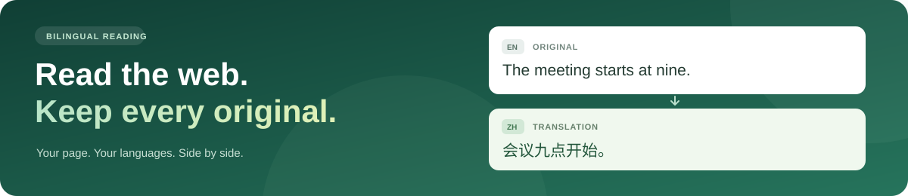

<h1 align="center">🌐 Bilingual Web Translator</h1>

<p align="center">
  <strong>Read web pages with original text and live translations</strong><br>
  A Chrome extension that keeps your reading in context.
</p>

<p align="center">
  
</p>

<p align="center">
  <a href="extension/manifest.json"></a>
  
  <a href="#languages"></a>
  <a href="LICENSE"></a>
</p>

<p align="center">
  📖 Original text preserved &nbsp; · &nbsp; ⚡ Dynamic content updates &nbsp; · &nbsp; 🎛️ Your choice of languages
</p>

<p align="center">
  <a href="https://github.com/Sver0411/bilingual-web-translator/raw/refs/heads/main/bilingual-web-translator.zip"><strong>📥 Download extension</strong></a>
  &nbsp; · &nbsp;
  <a href="README.zh-CN.md"><strong>🇨🇳 简体中文 README</strong></a>
</p>

---

<p align="center">
  <a href="#features">✨ Features</a> &nbsp; · &nbsp;
  <a href="#install">🚀 Install</a> &nbsp; · &nbsp;
  <a href="#usage">🎛️ Usage</a> &nbsp; · &nbsp;
  <a href="#languages">🌍 Languages</a> &nbsp; · &nbsp;
  <a href="#privacy">🔒 Privacy</a> &nbsp; · &nbsp;
  <a href="#development">🛠️ Development</a>
</p>

---

Translate ordinary HTTP and HTTPS web pages while keeping the original text and page interactions. The extension appears as **Bilingual Reader** in Chrome and supports paragraphs, buttons, links, cards, dynamic content, and open Shadow DOM.

<a id="features"></a>
## ✨ Features

| 📖 Read side by side | ⚡ Follow the page | 🌍 Make it yours |
| :--- | :--- | :--- |
| Keep the original and read translations in a floating panel or below the text. | New visible text is translated as you scroll, expand content, or update the page. | Detect the source automatically and choose from 16 target languages. |

| Feature | What you get |
| :--- | :--- |
| 🪟 **Floating panel** | A movable, collapsible translation panel that preserves the page layout |
| 📝 **Below the original** | Translations beneath supported paragraphs, buttons, links, and cards |
| 🔄 **Dynamic updates** | New visible content is translated automatically while the reader is enabled |
| 📌 **Per-site automation** | Automatic translation on individual websites you authorize |
| 🗣️ **Language controls** | Automatic detection or a manual source language, with an independent target language |
| 🎨 **Interface language** | System default, Simplified Chinese, English, or Japanese — selected in Settings |
| 🔌 **Provider choice** | Google web translation or your own chat-completions-compatible API |

<a id="install"></a>
## 🚀 Install in a minute

| Step | Action |
| :--- | :--- |
| **1 · 📥 Download** | Extract [bilingual-web-translator.zip](https://github.com/Sver0411/bilingual-web-translator/raw/refs/heads/main/bilingual-web-translator.zip), or clone this repository and use its `extension` folder. |
| **2 · 🧩 Load** | Open `chrome://extensions`, enable **Developer mode**, and click **Load unpacked**. Select the folder that directly contains `manifest.json`. |
| **3 · 📖 Read** | Refresh your web page, click the extension icon, and select **Translate this page**. |

> 💡 **Ready without a build step.** The default Google service needs no API key. Chrome 116+ and access to `translate.googleapis.com` are required.

<a id="usage"></a>
## 🎛️ Make it fit your reading

| You want to… | Do this |
| :--- | :--- |
| ⌨️ Toggle translation quickly | Press **Alt+A** on the current page. |
| 🗣️ Change the translation languages | Choose **Source language** and **Target language** in the popup. |
| 🪟 Keep the page layout | Use **Floating panel**; drag its title bar to move it. |
| 📝 Read translations below each passage | Select **Below the original**. |
| 🔎 Find the matching original | Click a translation in the floating panel. Hover over source text to view its translation. |
| 📌 Translate a site on every visit | Enable **Automatically translate this site** and allow Chrome's website permission request. Uncheck it to stop automatic activation. |
| 🎨 Change the extension interface | Open **Settings & translation service**, choose an interface language, and click **Save settings**. |

**Floating mode is the default.** Appending translations below the original can increase paragraph and control heights. Turning translation off removes added translations and restores styles adjusted by the extension.

<a id="languages"></a>
## 🌍 Three independent language choices

| Setting | Available choices |
| :--- | :--- |
| **Source language** | Automatic detection, or one of 16 common languages |
| **Target language** | Any of the 16 supported languages |
| **Interface language** | System default, Simplified Chinese, English, or Japanese |

Automatic source detection is performed by the selected translation service and is not limited to the manual list. The interface language defaults to the browser-provided UI locale; Chinese, English, and Japanese are supported, with English as the fallback. Switching the interface language does not change the translation languages or translate the page again.

<details>
<summary><strong>🗺️ View all 16 source and target languages</strong></summary>

| Language | Language |
| :--- | :--- |
| Chinese (Simplified) | Chinese (Traditional) |
| English | Japanese |
| Korean | French |
| German | Spanish |
| Portuguese | Italian |
| Russian | Arabic |
| Hindi | Thai |
| Vietnamese | Indonesian |

</details>

<a id="privacy"></a>
## 🔒 Translation services & privacy

- **Text goes to your selected provider.** When enabled, visible text near the viewport is sent for translation. Turning the reader off stops new requests; requests already sent may still finish.
- **Forms stay out of translation.** Login forms, passwords, input fields, and cookies are excluded. Up to 500 translations are cached in memory.
- **Automatic access is per site.** Manual translation uses temporary `activeTab` access. Automatic translation registers content scripts for websites you explicitly authorize.

The default Google web endpoint does not guarantee availability or translation accuracy. If it is unreachable or rate limited, retry or configure your own service in Settings.

<details>
<summary><strong>🔌 Custom providers & permission details</strong></summary>

Custom services must support `/chat/completions` over HTTPS; local HTTP endpoints are also supported. API keys are stored only in local extension settings and are not synced. Saving a custom service requests permission for that service's domain.

The existing abceed content-script scope is retained for compatibility with earlier settings. First-time permission dialogs can close the popup; the service worker retains the pending choice and completes setup after permission is granted.

</details>

## 📋 Supported content & limits

| Supported | Kept unchanged or restricted |
| :--- | :--- |
| Ordinary HTTP/HTTPS page text, supported controls, dynamic content, and open Shadow DOM | Images, canvas content, input fields, and login forms stay unchanged. There is no OCR or image-upload workflow. |
| Floating and appended translation displays | Chrome internal pages, the extension store, and the built-in PDF viewer restrict script injection. |

Closed Shadow DOM, unauthorized cross-origin frames, video subtitles, and native applications are not guaranteed to work.

> 📖 **Keep the original-language view.** Chrome's built-in whole-page translation can replace source text and interfere with bilingual reading.

<a id="development"></a>
## 🛠️ Development

```sh
npm ci
npm run check
npm test
npm run serve
```

The local demo runs at **`http://127.0.0.1:4173/`**. It uses self-authored English and Japanese exercises and the same text engine and display code as the extension; it does not contain the real abceed question bank.

**🧪 24 automated tests** cover original text-node identity and click handlers, style restoration, dynamic content and stale responses, open Shadow DOM, source/target language requests, independent interface-language changes, and permission setup that survives popup destruction. See the [validation notes](docs/验证记录.md) for the tested scope.

<details>
<summary><strong>🗂️ Project structure</strong></summary>

| File | Purpose |
| :--- | :--- |
| `extension/common.js` | Settings and text filtering |
| `extension/i18n.js` | Interface localization |
| `extension/engine.js` | Text extraction |
| `extension/content.js` | Bilingual display and dynamic updates |
| `extension/sites.js`, `extension/auto-sites.js` | Website permissions and automatic injection |
| `extension/background.js`, `extension/providers.js` | Translation scheduling and provider adapters |
| `extension/popup.html`, `extension/options.html` | Popup and settings interfaces |

</details>

This is an independently implemented extension inspired by bilingual reading workflows. It does not include Immersive Translate's proprietary code, icons, or branding, and does not claim feature parity with that product.

---

<p align="center">
  📖 Keep the original. Enjoy the translation.<br>
  <a href="LICENSE">MIT License</a> &nbsp; · &nbsp; <a href="README.zh-CN.md">简体中文</a>
</p>
